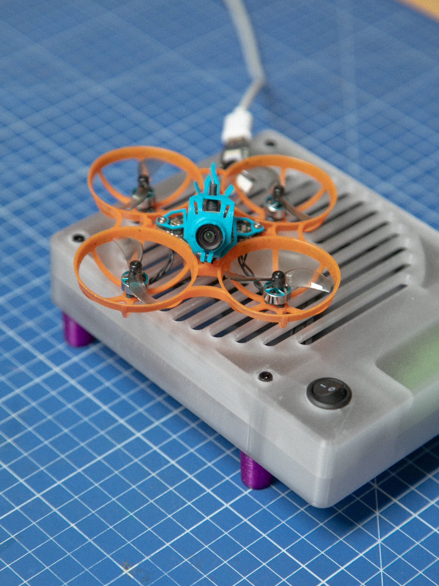
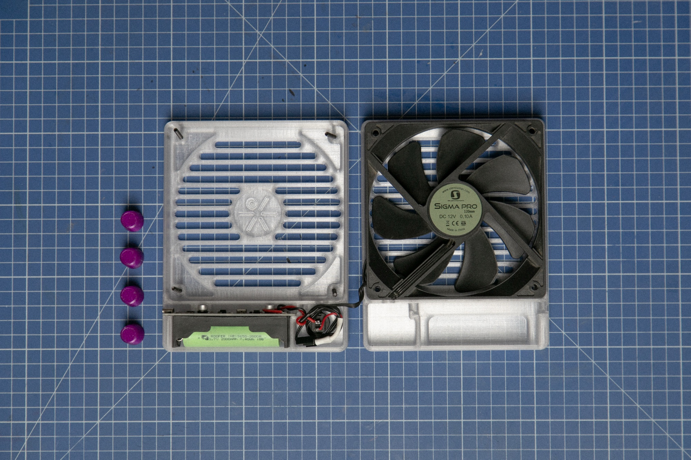
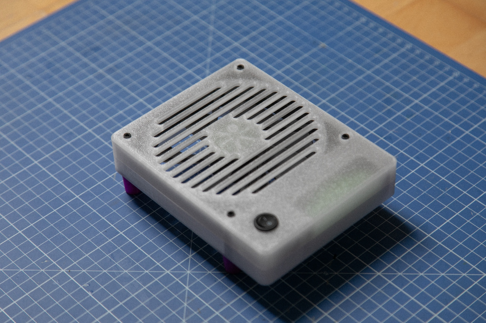

# Tinywhoop Workbench Cooling Fan

Tinywhoops overheat fast on the workbench. When the drone is plugged into a computer for configuration, the props aren't spinning and nothing cools the electronics. This fan fixes that.

It is built from a salvaged 120 mm PC fan and powered by an 18650 cell with USB-C charging. The two-part PETG enclosure prints without supports and is joined with screws. Semi-transparent filament shows what's going on inside. Soft TPU feet with embedded nuts keep the fan quiet by dispersing vibrations.

  
  

**Author:** Mikołaj Markowski ([@M1K0LAJ](https://github.com/M1K0LAJ))

## Parts list

**Electronics**

- 120 mm PC fan, 12 V (I used a salvaged SilentiumPC Sigma Pro, 12 V / 0.10 A; other 120 mm 12 V fans with the same frame size should fit, but I have not tested any)
- 18650 UPS power module, 12 V output, USB-C input (battery holder, charging and step-up on one board; mine came from msalamon.pl, search for "18650 UPS 12V USB-C module")
- 1x 18650 Li-ion cell (mine is a Roofer INR18650-2000A, 3.7 V, 2000 mAh)
- Round rocker switch, on/off, 10 mm
- Some wire and heat shrink tubing

**3D printed parts**

- Enclosure, 2 parts: PETG (I used semi-transparent), prints without supports
- 4x feet: TPU

**Hardware**

- 4x M3 x 38 mm socket head screws, they go through the whole enclosure
- 4x M3 nuts, embedded in the TPU feet

**Tools**

- 3D printer, soldering iron, hex key

## Files

| File | What it is |
| --- | --- |
| [`print/panel_top.stl`](print/panel_top.stl) | Enclosure, top half (fan grille) |
| [`print/panel_bottom.stl`](print/panel_bottom.stl) | Enclosure, bottom half |
| [`print/foot.stl`](print/foot.stl) | Foot (print 4x in TPU) |
| [`print/feet_with_nut_pause.3mf`](print/feet_with_nut_pause.3mf) | Feet with the nut pause already set up (BambuStudio project) |
| [`cad/panels.step`](cad/panels.step) | STEP model of both enclosure halves (the two solids are named `gora` = top and `dol` = bottom) |
| [`cad/battery_module_model.stp`](cad/battery_module_model.stp) | STEP model of the battery module |
| [`cad/cutouts_drawing.dxf`](cad/cutouts_drawing.dxf) | Cutout drawing (DXF) |

## Printing notes

- **Enclosure:** PETG, no supports needed.
- **Feet:** TPU. Add a pause in your slicer at the layer where the nut pocket is still open, drop the M3 nut in, then resume the print so the nut ends up sealed inside the foot. The 3MF in `print/` already has this pause set (BambuStudio). In another slicer, set the pause yourself.
- The model was designed in Rhino and sliced in BambuStudio. The original Rhino file is not included because of its size.

## Gallery

  
  
  

## License

Released under [Creative Commons Attribution-ShareAlike 4.0 International (CC BY-SA 4.0)](LICENSE). You are free to build, modify and share it, including commercially, as long as you credit the author (Mikołaj Markowski) and share your modifications under the same license.
