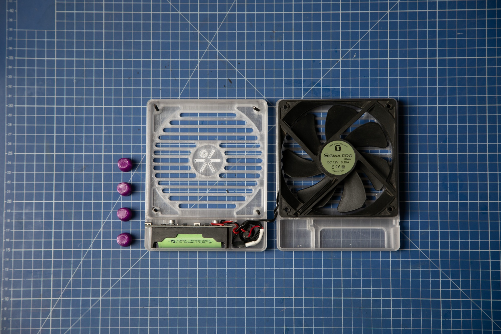
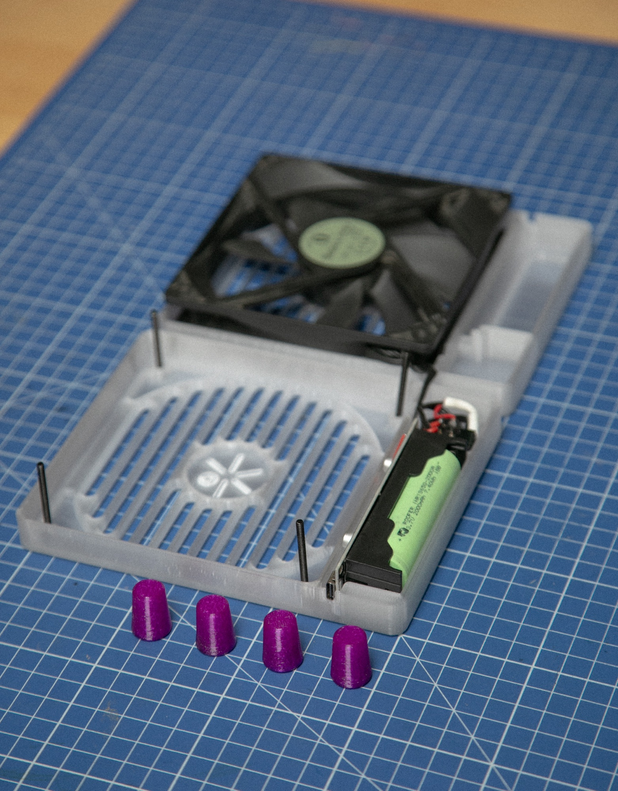

# Tinywhoop Workbench Cooling Fan

Tinywhoops overheat fast on the workbench. When the drone is plugged into a computer for configuration, the props aren't spinning and nothing cools the electronics. This fan fixes that.

It is built from a salvaged 120 mm PC fan and powered by an 18650 cell with USB-C charging. The two-part PETG enclosure prints without supports and is joined with screws. Semi-transparent filament shows what's going on inside. Soft TPU feet with embedded nuts keep the fan quiet by dispersing vibrations.

<p align="center">
  
  
</p>

**Author:** Mikołaj Markowski ([@M1K0LAJ](https://github.com/M1K0LAJ)), industrial designer and maker. Portfolio: [mikolajmarkowski.studio](https://mikolajmarkowski.studio). Project page: [mikolajmarkowski.studio/tinywhoop-fan](https://mikolajmarkowski.studio/tinywhoop-fan)

## Parts list

**Electronics**

- 120 mm PC fan, 12 V (I used a salvaged SilentiumPC Sigma Pro, 12 V / 0.10 A; other 120 mm 12 V fans with the same frame size should fit, but I have not tested any)
- 18650 UPS power module, 12 V output, USB-C input, with cell protection (battery holder, charging and step-up on one board; [example listing on AliExpress](https://pl.aliexpress.com/item/1005011844291829.html), mine came from msalamon.pl)
- 1x 18650 Li-ion cell (mine is a Roofer INR18650-2000A, 3.7 V, 2000 mAh)
- Round rocker switch, on/off, 15 mm (the hole in the top panel is Ø14.6 mm with a small chamfer, so measure your switch before printing; I don't know the exact model of mine, it is a fairly standard one)
- Some wire and heat shrink tubing

**3D printed parts**

- Enclosure, 2 parts: PETG (I used semi-transparent), prints without supports
- 4x feet: TPU

**Hardware**

- 4x M3 x 38 mm socket head screws, they go through the whole enclosure
- 4x M3 nuts, embedded in the TPU feet

**Tools**

- 3D printer, soldering iron, hex key

## Files

| File | What it is |
| --- | --- |
| [`print/panel_top.stl`](print/panel_top.stl) | Enclosure, top half (fan grille) |
| [`print/panel_bottom.stl`](print/panel_bottom.stl) | Enclosure, bottom half |
| [`print/foot.stl`](print/foot.stl) | Foot (print 4x in TPU) |
| [`print/feet_with_nut_pause.3mf`](print/feet_with_nut_pause.3mf) | Feet with the nut pause already set up (BambuStudio project) |
| [`cad/panels.step`](cad/panels.step) | STEP model of both enclosure halves (the two solids are named `gora` = top and `dol` = bottom) |
| [`cad/foot.step`](cad/foot.step) | STEP model of the foot |
| [`cad/battery_module_model.stp`](cad/battery_module_model.stp) | STEP model of the battery module |
| [`cad/cutouts_drawing.dxf`](cad/cutouts_drawing.dxf) | Cutout drawing (DXF) |

## Wiring

Everything runs on the 12 V output of the power module:

```text
18650 cell ──► power module (USB-C charging, step-up to 12 V)

module 12 V +  ────── switch ──────────►  fan red wire (+)
module 12 V −  ────────────────────────►  fan black wire (−)
```

The switch is soldered into the red (positive) wire of the fan. For a simple DC fan like this one it makes no practical difference whether the switch sits in the red or the black wire, switching the positive is just the more common choice. The cell is charged through the USB-C port of the module.

## Use

- **On the workbench:** the fan blows upward, out of the top grille, onto the drone sitting on it.
- **As a fume extractor:** stand it upright with the feet toward the soldering iron, and it blows the fumes away while you solder.

## Printing notes

- **Enclosure:** PETG, no supports needed. I printed mine in a slicer mode tuned for translucency; the exact settings were not recorded, so use your usual PETG profile.
- **Feet:** TPU, 4 pieces. The nut is sealed inside the foot during the print, so the print has to be paused once:
  1. Print until the nut pocket is fully open at the top. The pause in the 3MF is set at **Z = 5.0 mm**.
  2. Drop an M3 nut into the pocket and push it all the way down, so the nozzle does not catch it.
  3. Resume the print. The nut ends up sealed inside the foot.
- **3MF profile:** `print/feet_with_nut_pause.3mf` is a BambuStudio project for a Bambu Lab A1 mini (0.4 mm nozzle, Generic TPU, 0.20 mm layers, 2 walls, 30% gyroid infill, no supports) with the pause already set. On another printer or slicer, re-slice the STL and add the pause at Z = 5.0 mm yourself.
- The model was designed in Rhino and sliced in BambuStudio. The original Rhino file is not included because of its size.

## Assembly

1. Print the enclosure halves and the feet (with the nut pause, see above).
2. Solder the wires as described in Wiring. Leave them long enough to open the enclosure. Insert the cell, switch on and check that the fan spins before you close everything.
3. Top half (`panel_top`): fit the switch into its hole and press the power module with the cell into its pocket. The module is held by a press fit. Line up its USB-C port with the slot in the side wall.
4. Bottom half (`panel_bottom`): place the fan in it with the label side up, so it blows upward through the top grille.
5. Route the wires through the channel at the split line between the halves, so they are not pinched.
6. Close the halves and put four M3 x 38 mm screws from the top through both halves into the nuts in the feet. Do not overtighten them, TPU gives way easily.

## Safety

- Li-ion cells can catch fire if shorted, punctured, overcharged or deeply discharged. Use a cell from a reputable source and never a damaged one.
- Check the polarity before connecting the cell, and do not short the leads while soldering.
- The module I used has protection for the cell. Not every module does, so check the listing of the one you buy, and use a protected 18650 if the module has none.
- Do not leave the fan charging unattended. This is a DIY build, so build and use it at your own risk.

## Gallery

<p align="center">
  
  
  
</p>

## License

Released under [Creative Commons Attribution-ShareAlike 4.0 International (CC BY-SA 4.0)](LICENSE). You are free to build, modify and share it, including commercially, as long as you credit the author (Mikołaj Markowski) and share your modifications under the same license.
